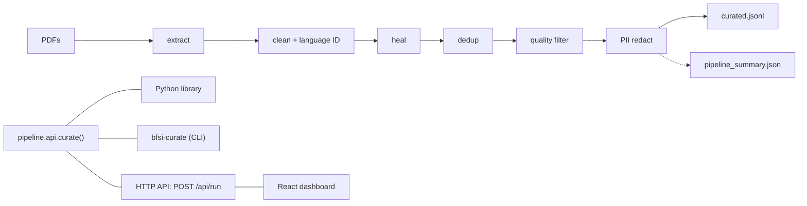

# BFSI/KYC Regulatory Data Curation Pipeline

[](https://github.com/A-001-byte/TCS-NemoCurator/actions/workflows/ci.yml)

Banks and regulators publish long PDFs: RBI Master Directions, FIU-IND guidelines, bank and NBFC KYC policies. Before a language model can be fine-tuned on them, the text has to be cleaned: page furniture removed, copies removed, personal data hidden, useful passages labelled. This repository does that automatically. You give it a folder of PDFs and it returns a fine-tuning-ready JSONL file, plus a dashboard that shows what every stage removed or changed and why.

Built for the TCS showcase on the ideas of NVIDIA NeMo Curator. **No model is trained here.** Fine-tuning (NVIDIA's Megatron-Bridge stage) is the next step in NVIDIA's data-curation → training → deployment chain and is out of scope.

## Numbers

Full run on the 35 public PDFs in `data/raw/`. This table is generated from the dashboard snapshots by `scripts/make_final_numbers.py` and a test fails if it goes stale; the full breakdown is in [`docs/FINAL_NUMBERS.md`](docs/FINAL_NUMBERS.md).

<!-- numbers:start (generated by scripts/make_final_numbers.py, do not edit by hand) -->

| Measure | Result |
|---|---|
| PDFs in / readable | 35 / 34 |
| Final curated chunks | 3,325 (3,810,453 characters) |
| Removed by dedup / by the quality filter | 330 / 71 |
| Tagged as regulatory (2 or more keywords) | 1,913 (57.5%) |
| Personal-data items hidden | 68 (name detection on) |
| Training text (tiktoken:cl100k_base) | 803,179 tokens |
| Document type found, whole near-copy family held out | 55.9% (guessing the biggest type: 29.4%) |
| Removed on the same 3,396 chunks: NeMo Curator 1.3.0 / ours | 716 (21.1%) / 71 (2.1%) |
| Compute device (quality stage) | cpu |

<!-- numbers:end -->

The PII figure is mostly official contact details printed in public documents (government emails, office PIN codes), which the pipeline hides anyway. It does not claim to have found private data.

## What is real, and what is not

**Real**
- All 35 input PDFs in `data/raw/` are public documents from the original sources (RBI, FIU-IND, SEBI/AMFI, bank and NBFC websites, law-firm summaries). Nothing is synthetic. One is a scan with no text layer; it is reported, not crashed on.
- Every count on the dashboard is computed by the pipeline, not typed in.
- **Real NVIDIA NeMo Curator 1.3.0** was installed on a Linux VM and run on the same chunks as our quality stage (`pipeline/nemo_compare.py`, `XennaExecutor` on CPU). The table above has the counts. NeMo's default filters remove about ten times as many chunks as ours; most of that comes from its duplicated-5-gram filter and from two FIU report-format guides, which are tables of repeated field descriptions. NeMo's defaults are tuned for web text, so this shows a difference in design, not that either side is wrong. **We have not hand-checked the chunks only NeMo removes.**
- The 16 newest documents were never used when the rules were tuned. Running them found 7 false PII alarms (digits inside statistics tables and placeholders such as `0000000000`), which are now rejected. Details in [`docs/IMPROVEMENT_LOG.md`](docs/IMPROVEMENT_LOG.md).

**Our own implementations ("equivalent-logic" stages), not calls into NeMo**
- **Dedup:** SHA-256 exact matching plus MinHash/LSH fuzzy matching (`datasketch`), run on the CPU. NeMo's own dedup needs a GPU ([`docs/A1_3_dedup_gpu_finding.md`](docs/A1_3_dedup_gpu_finding.md)). When several versions of one policy exist, the newest is kept.
- **Quality filter:** heuristics (alpha ratio, symbol ratio, lexical diversity, minimum words) plus regulatory-keyword tagging. NVIDIA's DeBERTa quality classifier was tested and **rejected as a filter** because it is about 17x stricter and judges layout, not quality ([`docs/A1_4_quality_classifier_comparison.md`](docs/A1_4_quality_classifier_comparison.md)). It remains as an optional, off-by-default label (`QUALITY_SIGNAL_MODE`) that never removes a chunk.
- **PII:** regex plus spaCy, with context checks: dates only after a birth cue, PIN codes only with an address context, Aadhaar by Verhoeff checksum, SWIFT only with a label, and account numbers only with a bank cue and not inside numeric tables. GLiNER is available behind `USE_GLINER_PII` (off by default).

**Document-type classifier (small, honestly scored).** A nearest-centroid classifier over 6 document types, built on the clause-search TF-IDF (`dashboard/src/doctype.js`). It is scored with each document's whole near-copy family held out; the table above has the score and the guessing baseline. Four combinations were scored on the same 34 documents and two types were merged after seeing the confusion table, so treat the score as the optimistic end; `fiu_reporting_spec` is still 0%. It is not a trained fraud or anomaly model. Results: `dashboard/public/doctype_eval.json`.

**Not built:** OCR for scanned PDFs, any model training, a hosted/cloud service. GPU use is limited to the optional GLiNER and DeBERTa models; the default pipeline, including dedup, runs on the CPU.

## How it works: 7 stages (the order matters)



| # | Stage | What it does |
|---|---|---|
| 1 | extract | Reads text from each PDF (`pdfplumber`). Image-only PDFs fail cleanly and are counted. |
| 2 | clean + language ID | Normalises text; drops anything too short or not English. |
| 3 | heal | Removes page furniture (repeated letterheads, footers) and repairs words split by the PDF layout, so furniture cannot hide duplicates or pose as PII. |
| 4 | dedup | Exact then fuzzy; keeps the newest policy version; separates boilerplate shared across documents from copies inside one document. |
| 5 | quality filter | Drops numeric, symbol-heavy and repetitive chunks; tags regulatory vocabulary and density. |
| 6 | PII redact | Replaces personal data with `[REDACTED_TYPE]` placeholders. |
| 7 | output | One JSON line per chunk: `{"text": ..., "metadata": {...}}`. |

PII redaction runs **after** dedup on purpose: dedup relies on stable content hashes, and redacting first would write different placeholder text per occurrence and silently break duplicate detection. Heal runs **before** dedup for the reason in the table.

Each stage writes a record `{stage, docs_in, docs_out, removed, reason_counts}`; output lines carry `{text, metadata}`. These two shapes are frozen: fields may be added, never renamed or removed. The metadata of an output line is `chunk_id, doc_id, source_file, pii_redacted, regulatory_tagged, regulatory_keywords_found, regulatory_density_score, quality_classifier_label`.

## Install

Python 3.11 or newer. Linux is the reference platform (CI runs on Ubuntu); Windows works for everything except real NeMo Curator.

```bash
git clone https://github.com/A-001-byte/TCS-NemoCurator.git
cd TCS-NemoCurator
python3 -m venv venv && source venv/bin/activate     # Windows Git Bash: source venv/Scripts/activate
pip install -r requirements-dev.txt                  # the pipeline plus the test tools
python3 -m pytest -q                                 # all tests, no network needed
```

| File | Adds | When you need it |
|---|---|---|
| `requirements.txt` | the whole default pipeline (no torch, no NeMo) | always |
| `requirements-dev.txt` | pytest, coverage, ruff | to run the tests |
| `requirements-ml.txt` | torch, transformers, GLiNER | the optional PII and quality models |
| `requirements-gpu.txt` | the above plus cuDF | an NVIDIA GPU and driver |
| `requirements-nemo.txt` | real NeMo Curator 1.3.0 | `pipeline/nemo_compare.py`, Linux or WSL2 only |

[`SETUP.md`](SETUP.md) has the step-by-step Linux/WSL2 install, the GPU notes and the known pitfalls.

**With Docker instead of Python** (nothing to install but Docker; CPU only, no GPU models):

```bash
docker build -t bfsi-curate .
docker run --rm --user "$(id -u):$(id -g)" -v "$PWD:/data" bfsi-curate run /data/pdfs -o /data/out
```

The image runs the `bfsi-curate` command as an ordinary user; your PDFs and the output live in the mounted folder. To use the dashboard's API from the container, publish the port on your own machine only: `docker run --rm -p 127.0.0.1:8000:8000 bfsi-curate serve --host 0.0.0.0`. CI builds the image and curates a real PDF in it on every pull request.

## Use it three ways

All three call the same function, `pipeline.api.curate`, and a test checks that they return identical output. Every library, CLI or API run happens in a temporary folder, so `data/` is not touched.

**1. Python library**
```python
from pipeline.api import curate

result = curate("pdfs/", "out/")  # all 7 stages on every *.pdf in pdfs/
print(result.summary["final_output_chunks"])  # out/curated.jsonl and out/pipeline_summary.json are written
```

**2. Terminal**
```bash
pip install -e .                                   # installs the `bfsi-curate` command
bfsi-curate run pdfs/ -o out/ --device auto        # or: python -m pipeline.cli run pdfs/ -o out/
bfsi-curate serve                                  # the HTTP API below, on 127.0.0.1:8000
```
Exit codes: `0` success, `1` the pipeline stopped (a one-line reason is printed; `--verbose` adds the log), `2` bad input or arguments, `130` Ctrl+C.

**3. HTTP API and dashboard**
```bash
python -m pipeline.server                          # API on 127.0.0.1:8000
cd dashboard && npm install && npm run dev         # dashboard; /api is proxied to the server above
```

| Method and path | Purpose | Answers |
|---|---|---|
| `GET /api/health` | liveness and version | `200 {"ok": true, "version": ...}` |
| `POST /api/run` | curate uploaded PDFs: `{"files": [{"name": "x.pdf", "data": "<base64>"}]}` returns `{summary, curated_jsonl, log}` | `200`, `400` bad request, `409` another run is in progress, `413` too large, `422` the pipeline stopped, `500` |
| `POST /api/refresh` | re-run the whole corpus in the background and republish the dashboard snapshots | `202` started, `409` already running |
| `GET /api/refresh/status` | `{"state": "idle" \| "running" \| "succeeded" \| "failed", ...}` | `200` |

A known path with the wrong method returns `405` with an `Allow` header, an unknown path `404`, and every error is `{"error": "<what went wrong>"}`.

Limits and safety: at most 10 files and 30 MB per upload; one run at a time; **no authentication**, so the server listens on loopback (`127.0.0.1`) by default. Keep it that way unless the network is trusted. See [`SECURITY.md`](SECURITY.md).

## Configuration

| Setting | Values | Effect |
|---|---|---|
| `CURATOR_DEVICE` | `cpu`, `cuda` | forces the compute device for the optional models; default is auto-detect with CPU fallback (`--device` on the CLI wins) |
| `CURATOR_HOST`, `CURATOR_PORT` | address, port | where the server listens; the `--host` and `--port` flags win |

The optional models are off by default. After installing `requirements-ml.txt` with a CUDA-enabled PyTorch build, use `bfsi-curate run pdfs/ -o out/ --device cuda --pii-engine gliner --quality-signal model` to use both. GLiNER replaces regex + spaCy and has different validation behavior. The DeBERTa signal adds labels without filtering chunks. The other pipeline stages still run on CPU. See [`SETUP.md`](SETUP.md) for the one-time GPU install.

A full run takes about 5.5 minutes on a quiet laptop CPU and up to about 12 minutes on a busy one.

## Tests

```bash
python3 -m pytest -q                               # the Python tests
python3 -m pytest --cov                            # with coverage (the CI floor is 80%)
ruff check . && ruff format --check .              # lint and format
cd dashboard && npm run lint && npm test && npm run build
```
The `python -m pipeline.test_*` scripts are the older self-checks and still pass. Rules that changed behaviour have a test that fails when the rule is broken. CI (`.github/workflows/ci.yml`) runs all of this on every pull request. How to contribute: [`CONTRIBUTING.md`](CONTRIBUTING.md).

## Repository layout

```
data/raw/        the 35 source PDFs (the only tracked folder under data/)
data/extracted/ cleaned/ healed/ deduped/ filtered/ redacted/ output/   per-stage results (untracked)
pipeline/        one module per stage, plus api.py (library), cli.py, server.py, nemo_compare.py,
                 refresh_snapshots.py, device.py, doc_type_labels.json, doc_type_families.json
tests/           the pytest suite
dashboard/       React (Vite) front end; src/doctype.js is the document-type classifier;
                 public/ holds the snapshots the dashboard reads
scripts/         make_final_numbers.py (generates FINAL_NUMBERS.md and the table above)
docs/            see docs/README.md for the index
SETUP.md         Linux / WSL2 setup, GPU notes
STATUS.md        what is done, what is not, known issues
```

The dashboard reads the committed snapshots in `dashboard/public/`. To regenerate them, run `POST /api/refresh` (or the dashboard's refresh button), then `python scripts/make_final_numbers.py`.

## Where we deliberately stopped

```
Data Curation → Pre-training & SFT/LoRA → Post-training/RL → Inference
  [THIS REPO]     [Megatron-Bridge,          [RL]            [Export-Deploy,
                   AutoModel]                                  Eval, Guardrails]
```
